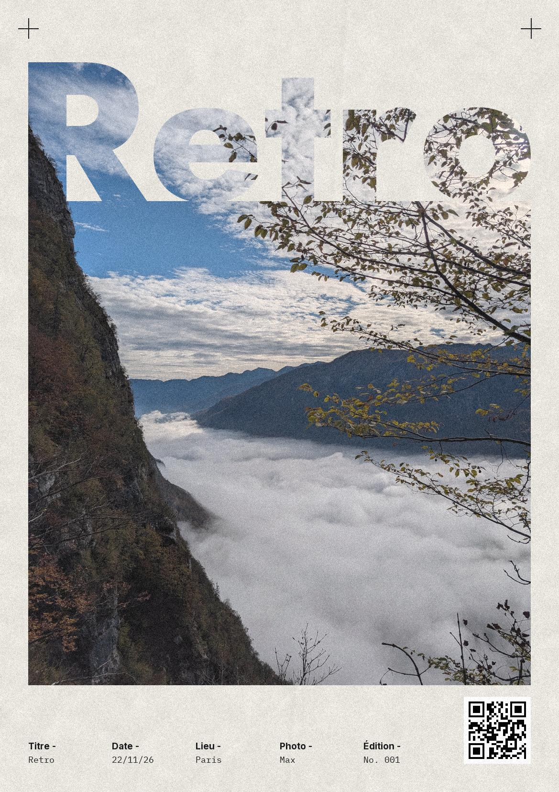

# poster-maker

Turn your own photos into print-ready retro posters. One command, one TOML config.



*A3 portrait. The photo continues up through the letters of the title. Everything around it is generated paper with film grain.*

**What you get**
- A full-width photo with a giant title filled by the photo itself (or the whole photo with no title)
- Portrait or landscape output, following your photo
- A3, 50x70 cm or any custom size, with a DPI you can set
- A footer with an info row (in any language) and a Spotify code or QR code
- Generated paper texture, vintage colour grade and film grain, all adjustable

```bash
uv sync
uv run python poster.py config/poster.toml
uv run pytest
```

The page orientation follows the photo: portrait photos make portrait posters, landscape photos make landscape posters.

## Config

Everything lives in `config/poster.toml` (see the comments inside). Highlights:

| Key | What it does |
|---|---|
| `size` | `"A4"` (proofs), `"A3"`, or any `"<w>x<h>"` in cm such as `"50x70"` |
| `dpi` | optional; defaults to 300 for A4/A3 and 150 for bigger formats |
| `orientation` | `"auto"` (follows the photo), `"portrait"` or `"landscape"` |
| `show_title` | `false` hides the giant title and shows the whole photo (also `--no-title`) |
| `title_width` | fraction of the page width the title fills (try `0.7` on landscape) |
| `focus` | `[x, y]` part of the photo kept in frame when a crop is needed |
| `spotify` | Spotify link or URI; the code is downloaded once and cached in `assets/spotify/` |
| `url` | QR code, used when `spotify` is not set |
| `[effects]` | saturation, contrast, warmth, fade, grain, paper texture strength, creases |

Command-line overrides: `--photo`, `--size`, `--dpi`, `--orientation`, `-o/--output`.

```bash
uv run python poster.py config/poster.toml --size 50x70 --photo photos/trip.jpg
```

A warning is printed when the photo is too small for the chosen size (about 150 ppi for A-sizes, 100 ppi for large posters).

## Fonts

Static fonts are in `fonts/` (SIL Open Font License, licences included): Jost ExtraBold, Inter Bold and IBM Plex Mono Regular. Jost and Inter are instanced from the Google Fonts variable files with fontTools.
